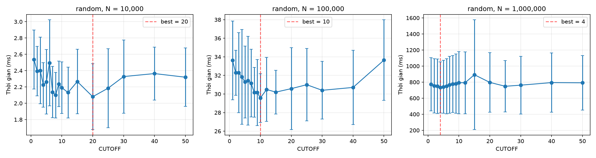
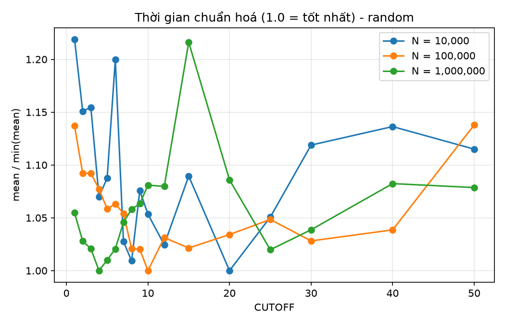

# Thí nghiệm tìm CUTOFF tối ưu cho Mergesort

Dự án thực nghiệm: tìm giá trị **CUTOFF** tốt nhất khi cài đặt Mergesort.

- **Sinh viên:** Vũ Quang Hà – MSSV: 25021746
- **Lớp học phần:** UET.CS1058_8
- **Báo cáo đầy đủ:** [`report/BaoCao_CutoffMergesort.docx`](report/BaoCao_CutoffMergesort.docx)

## Kết quả chính

| Nội dung | Kết quả |
|---|---|
| CUTOFF tối ưu (tổng hợp 9 cấu hình) | **7 – 10** (điểm thấp nhất tại 7; chênh với 8, 9, 10 nhỏ hơn nhiễu đo) |
| So với giáo trình (7 và 10) | Cả hai nằm trong vùng tối ưu |
| Dữ liệu ngẫu nhiên | Đáy đường cong phẳng; chỉ CUTOFF 1, 2 và ≥ 40–50 kém rõ rệt |
| Dữ liệu sắp xếp ngược | Ưu tiên CUTOFF nhỏ (7 – 8) |
| Dữ liệu gần có thứ tự | Ưu tiên CUTOFF lớn (≥ 40, có thể > 50) |
| Nhanh hơn Mergesort thuần | ~6–22% (ngẫu nhiên), tối đa ~60% (gần có thứ tự) |

**Lưu ý:** với N = 10⁶ độ nhiễu đo rất lớn (độ lệch chuẩn ~40% trung bình) nên kết quả ở N này kém tin cậy; xem mục *Hạn chế* trong báo cáo.





## Thiết kế thí nghiệm (tóm tắt)

- Biến thay đổi: CUTOFF ∈ {1–10, 12, 15, 20, 25, 30, 40, 50}; N ∈ {10⁴, 10⁵, 10⁶}; dữ liệu: `random`, `nearly_sorted`, `reversed`.
- Dữ liệu sinh một lần với seed cố định (12345), mọi CUTOFF dùng chung.
- Mỗi cấu hình: 5 vòng warm-up, 20 lần đo; đo bằng `System.nanoTime()` quanh lệnh sort trên bản sao mới.
- Thống kê: mean, std, median, khoảng tin cậy 95%.
- Máy đo: Intel Core i7-13620H, 24 GB DDR5, Windows 11, Java 25.0.2 (chi tiết trong `results/system_info.txt`).

## Cấu trúc thư mục

```
├── src/                  Mã Java
│   ├── MergeCutoff.java  Mergesort có tham số CUTOFF
│   ├── Insertion.java    Insertion sort trên đoạn [lo, hi]
│   ├── DataGenerator.java  Sinh / lưu / đọc dữ liệu
│   ├── Experiment.java   Chương trình chạy thí nghiệm
│   └── SortCheck.java    Kiểm tra kết quả đã sắp xếp
├── scripts/
│   ├── run_experiment.bat  Chạy toàn bộ (Windows)
│   └── analyze.py          Thống kê và vẽ đồ thị
├── data/                 Bộ dữ liệu đầu vào
├── results/              results.csv, summary.csv, summary.md, system_info.txt, figures/
├── report/               Báo cáo thí nghiệm (.docx)
```

## Cách chạy lại

Yêu cầu: JDK (có `javac`), Python 3 với `pandas`, `matplotlib`, `tabulate`. 
Chạy `Experiment.main()` trong IntelliJ rồi `python scripts/analyze.py` từ thư mục gốc. Thí nghiệm mất vài phút, Chạy lại sẽ ghi đè `results/`.

## Ghi chú về sử dụng AI

Có dùng trợ lý AI (Claude) hỗ trợ dựng khung project, soạn báo cáo; thí nghiệm được chạy trên máy của tác giả.